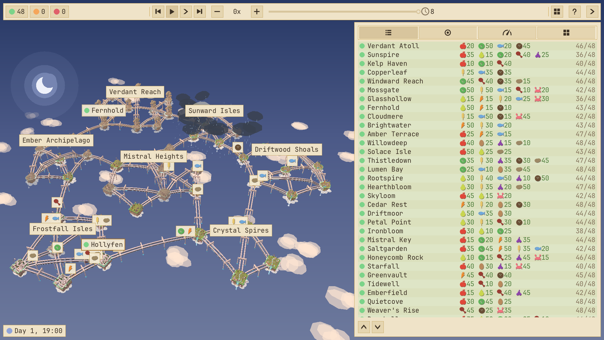

# SolarPunk

A solarpunk sky-island logistics simulator written in C. Islands produce and need food, announce it to their neighbours, and route goods hop by hop across the sky. There is no central planner: each island decides only from what it can see of its direct neighbours. The world is drawn in 3D with a small OpenGL rectangle renderer.



## Running

A Windows build is included. Run:

```bat
build\solarpunk.exe
```

The executable loads the game from `solarpunk_app.dll` and the fonts from the same `build/` folder, so keep these files together.

## Folder structure

```
build/                      ready-to-run Windows build
  solarpunk.exe             the platform layer: opens the window and loads the game
  solarpunk_app.dll         the game itself
  *.ttf                     text and icon fonts
code/solarpunk/             game source (unity build: solarpunk.c includes the rest)
  solarpunk.c / .h          entry point and app state
  solarpunk_world*.c        world model and world generation
  solarpunk_*_island.c      the island types (hero, forest, fishing, ice, beach, crystal, ruins)
  solarpunk_food*.c         food production and needs
  solarpunk_broadcast*.c    islands announcing supply and need to their neighbours
  solarpunk_routing.c       hop-by-hop routing of goods
  solarpunk_supply.c,
  solarpunk_distribution.c  supply planning and sharing
  solarpunk_render3d.c,
  solarpunk_view3d.c        3D renderer and camera
  solarpunk_ui.c, _panel.c  control bar and side panel
  solarpunk.mdesk           metadata; generated/ holds the code made from it
  sim/solar_sim.c           SolarSim: headless tests and simulation runs
docs/                       design docs
licenses/                   licenses for the bundled fonts and libraries
```

The design docs live in [`docs/`](docs/). Start with `01_OVERVIEW.md` for what the project is and the world rules, then `03_TECH_SPEC.md` for how the engine works.

## Credits

The base layer, `rl` and the cling build script are from Luca's [Unknown](https://git.keyfried.com/luca/unknown) codebase.
Third-party code: stb (public domain), glad, xxHash (BSD-2), Metadesk, JetBrains Mono (OFL) and Fontello icons (MIT).
